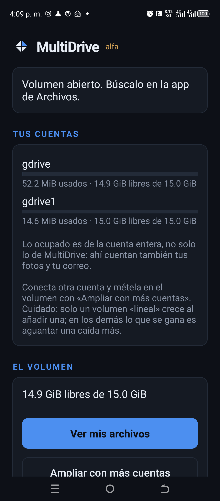
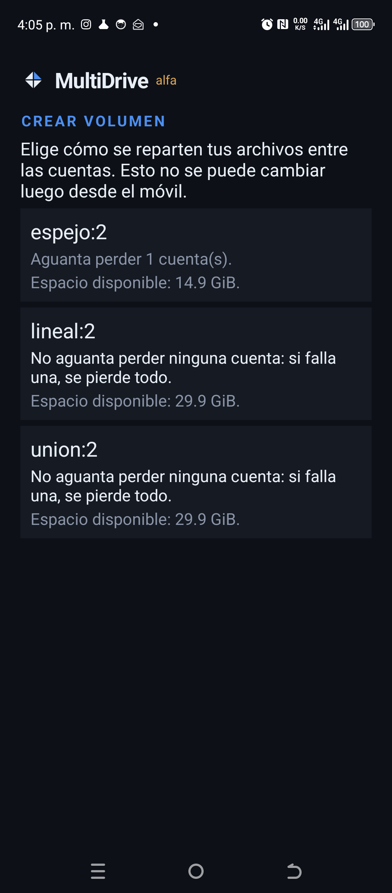
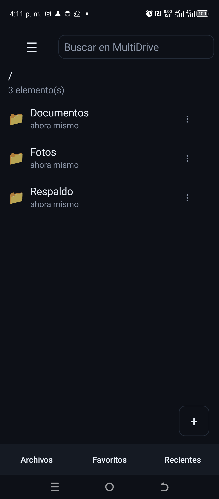
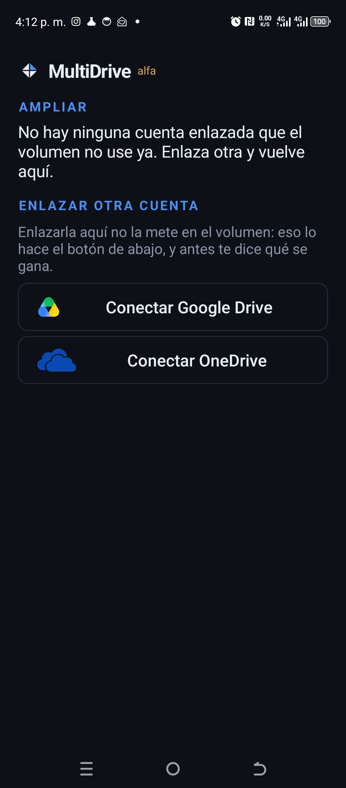

# MultiDrive

[Español](README.md) · **English**

**One drive. Many clouds.**

MultiDrive aggregates several cloud storage services (S3/B2/R2/Wasabi/Storj, WebDAV/Nextcloud,
Google Drive, OneDrive) into **a single virtual volume** that mounts as just another system
drive on Windows and Linux, and that on Android shows up inside the system Files app, with
RAID-like semantics (mirroring, striping and parity via *erasure coding*) and **zero-knowledge
encryption**.

> Status: **alpha.** The core works and is covered by tests: encryption, RAID, chunking,
> the copy-on-write metadata tree and rescue. Google Drive and OneDrive pass the conformance
> suite against real accounts. **It mounts as a read-write drive on Windows**, with in-memory
> and on-disk caches and background upload. **There is an Android app**, in internal testing
> on Google Play, that creates volumes, grows them, deletes them, reads, writes, and uploads
> whichever phone folders you point it at.
>
> Alpha means the main paths work and get daily use, and that pieces are still missing:
> thumbnails, a web version, and of the providers only Drive and OneDrive are verified
> against real accounts. **This is not where you keep the only copy of anything.**

Project site: https://multidrive.net

## Try it

### 👉 [Sign up for the Android testing](https://multidrive.net/en/#try-it)

The app is in **Google Play internal testing**: you don't find it in the store, you get in by
invitation. That link has a form; leave your address and you go on the list.

It has to be **the Google account you use on the phone**, not another address: Google sends the
invitation there and only that account can accept it. The invitation is not instant, because
the list is added by hand.

You need Android 8 or later and an `arm64-v8a` phone. **The interface is in Spanish only.**

> The form cannot live in this README: GitHub strips `<form>` and `<input>` when it renders the
> page, so a link is what is left.

### 💻 [Download for Windows](https://github.com/lmoraperez/multidrive/releases/latest)

64-bit Windows. Two files, and for almost everyone the right one is
`multidrive-0.0.1-x64-completo.exe`, which bundles **WinFsp**: that is what lets the volume
show up as a system drive. The bare `.msi` is for people who already have WinFsp or deploy it
themselves.

They are **unsigned**, so SmartScreen will warn that it doesn't recognise the publisher. The
`sha256` sums to check what you downloaded are in the [release
notes](https://github.com/lmoraperez/multidrive/releases/tag/v0.0.1-windows).

You can also build it from source: [Installing on Windows](#installing-on-windows).

## In thirty seconds

[](https://multidrive.net/en/#spot)

It has no sound: it tells the story with on-screen text. **The player is on
[multidrive.net](https://multidrive.net/en/#spot)**, not here: GitHub only plays video hosted on
its own domains, so this is the poster and the link.

> **A note on language.** This project is written in Spanish: the command names and flags, the
> code, the commit messages and every document under [`docs/`](docs) are Spanish. That is why
> you will read `multidrive mount Z: --escritura` below and not `--write`. This file and
> [the English home page](https://multidrive.net/en/) are translations; the Spanish originals
> are the ones that get updated first.

## Installing on Windows

There are two downloads on the releases page, and the one you want is almost certainly the
first:

| | |
|---|---|
| `multidrive-X.Y.Z-x64-completo.exe` | Installs **WinFsp and MultiDrive**. This is the normal one. |
| `multidrive-X.Y.Z-x64.msi` | MultiDrive only; refuses to install if WinFsp is missing. For people who manage WinFsp themselves. |

Both install **the window and the command**: they leave a "MultiDrive" shortcut on the desktop
and another in the start menu, and `multidrive` ends up on the PATH for any console.

If you don't want the desktop one, the MSI will take no for an answer:

```
msiexec /i multidrive-X.Y.Z-x64.msi ACCESO_ESCRITORIO=0
```

WinFsp is what provides the driver that makes the drive appear. The full installer **chains
WinFsp's own installer unmodified, exactly as its project publishes it**, and detects it if
already present: it doesn't touch it, reinstall it, or remove it when MultiDrive is
uninstalled. Other programs may be using it.

> **The window needs WebView2**, which is what draws its interface. Windows 11 ships with it
> and up-to-date Windows 10 installs do too; if it's missing, the window says so with a
> message and a link instead of just dying. The `multidrive` command works fine without it.

> **You need to reboot once after installing WinFsp.** Its network provider registers at boot,
> so until the first reboot `net use` answers "system error 67" even when everything else is
> fine. Mounting with `multidrive mount Z:` works from the very first moment.

> **They are not signed yet.** Windows will announce them as coming from an "unknown
> publisher" and SmartScreen will warn you the first time. What that costs and why it's still
> unresolved is in [docs/FIRMA.md](docs/FIRMA.md) (Spanish). Check the SHA-256 against the one
> published with the release.

Building them from source needs the .NET SDK and WiX 5:

```powershell
winget install Microsoft.DotNet.SDK.8
dotnet tool install --global wix --version 5.0.2
wix extension add --global WixToolset.BootstrapperApplications.wixext/5.0.2
.\packaging\windows\construir-msi.ps1            # both
.\packaging\windows\construir-msi.ps1 -SoloMsi   # no network, MSI only
```

To have the volume available without keeping a console open, it registers with the WinFsp
launcher and connects as a network drive: **Windows asks for the passphrase when connecting
and it is not stored anywhere.** See [docs/SERVICIO.md](docs/SERVICIO.md) (Spanish).

## Trying it

Needs stable Rust (2024 edition). The desktop window uses the system webview: on Windows it's
already there (WebView2), and on Linux you need its headers —`libwebkit2gtk-4.1-dev
libgtk-3-dev librsvg2-dev pkg-config` on Debian and derivatives.

**On Windows you need the MSVC toolchain**, not GNU: `winfsp-sys` —what makes mounting
possible— does not build with `x86_64-pc-windows-gnu` and says so with an `unsupported triple`
in the middle of the build, which looks nothing like the problem it actually is. If `rustup
show active-toolchain` says `gnu`:

```sh
rustup toolchain install stable-x86_64-pc-windows-msvc
rustup override set stable-x86_64-pc-windows-msvc    # this directory only
```

That's a **per-path** override: if you move or rename the repository folder it's orphaned and
the build falls back to GNU. `rustup override unset --nonexistent` cleans up the leftovers.

```sh
cargo test --workspace          # 356 tests
cargo run -- layout rs:4,2      # fault tolerance and overhead of a topology
cargo run -- demo --layout rs:4,2 --kib 512
cargo run -- check              # conformance of the configured providers
```

`demo` runs the whole cycle over local directories, one per "provider": it writes an encrypted
and distributed chunk, **destroys two entire providers**, reads it back intact and regenerates
the missing shards.

## A real volume

With providers configured (see [docs/PRUEBAS-PROVEEDORES.md](docs/PRUEBAS-PROVEEDORES.md),
Spanish) and a passphrase:

```sh
export MULTIDRIVE_PASSPHRASE='...'        # there is no recovery: lose it and you lose everything
cargo run -- volume create --layout rs:2,1
cargo run -- put ./movie.mkv /media/movie.mkv
cargo run -- ls /media
cargo run -- cat /media/movie.mkv --offset 1000000 --len 64   # downloads only the chunk it needs
cargo run -- get /media/movie.mkv ./back.mkv
cargo run -- scrub                        # what each chunk is missing, and where
cargo run -- providers list               # the volume's providers, and any extra configured ones
cargo run -- providers add --mas-seguridad   # one more failure of margin (cheap)
cargo run -- providers add --mas-espacio     # more capacity (on lineal it only moves the newcomer's share)
cargo run -- providers remove fs2 --menos-seguridad   # drop one, even if it no longer answers
cargo run -- rebuild                      # regenerate whatever is missing
cargo run -- volume migrar                # volume from before the rename: rewrites its header
cargo run -- config publicar              # stores the encrypted configuration in your own clouds
cargo run -- config recuperar             # brings it to this machine: one linked account is enough

cargo run -- header export ./header.json  # backup: without the salt there is no key
cargo run -- rescue                       # if the root pointer is lost

cargo run -- put ./big.mkv /media/big.mkv --diferido   # returns immediately
cargo run -- sync                                      # and uploads when it's time
cargo run -- mount Z:                        # mount it as a drive (Windows)
cargo run -- mount Z: --escritura            # ...and be able to write (uploads every 30 s)

cargo run -p multidrive-gui                   # the desktop window
```

## Mounting

On Windows, `multidrive mount Z:` exposes the volume as a system drive: Explorer lists folders,
any program opens files and `Copy-Item` copies. Requires [WinFsp](https://winfsp.dev), which
the full installer brings, and Rust's **MSVC** toolchain to build.

With `--escritura` it mounts **read-write**. What you write stays on this machine and a
background thread uploads it every `--sync-cada` seconds (30 by default); on unmount, whatever
is left goes up before exiting.

Reading is reasonable because there is an in-memory cache (`--cache-mb`, 512 by default): the
first read of each chunk goes to the cloud, later ones don't. Measured against a local
provider, re-reading 7.6 MiB goes from 2,718 ms to 23 ms.

There is also an **on-disk cache** (`--disco-mb`, 4096 by default) that survives reboots, so
mounting again doesn't pay for the network a second time. It stores the chunks **encrypted**:
the data never sits in the clear on the machine.

On Linux, `multidrive mount /empty/path` does the same with FUSE, and it's tested end to end:
reading and writing with the content intact, renaming folders with things inside them, and the
error codes `rm -r` needs in order not to give up. CI checks it on every change, mounting for
real.

> **With `fusermount3` 3.18.2 mounting needs root**, and it isn't the adapter's fault: that
> helper refuses the descriptor it is handed. As root it isn't needed, because then it mounts
> with `mount(2)` directly. With 3.14.0 it mounts unprivileged, which is what CI checks. The
> detail, and what's still open, is in [docs/ROADMAP.md](docs/ROADMAP.md) (Spanish).

## Android

| | | | |
|:-:|:-:|:-:|:-:|
|  |  |  |  |
| The volume, open | Pick the layout | Your files | Grow it later |

Screenshots taken on a handset running the published build. Not mocked up, not retouched. **The
app's interface is in Spanish only**, like the rest of the project; there is no English build
yet.

There is an **Android app**, published on Google Play as `com.jlsoltech.multidrive`. It is in
**internal testing**: you install it from the testing link, not by searching the store. It
needs Android 8 or later and is `arm64-v8a` only, which is what phones have carried for years.

It is not a viewer for what the desktop did: from the phone you can **create** a volume
—picking providers and topology just like in the desktop window—, **grow** it with new
accounts, and **delete** it. And to open it you don't have to link every account again one by one: with **one**
linked account and the passphrase, the sealed configuration brings in the rest. On a phone that
matters, because each account means another trip to the browser and another permission screen
typed on a phone keyboard.

What it does, once open:

- **Shows up in the system Files app** as one more storage location, and in the file picker of
  any app that asks for a file. That's what a `DocumentsProvider` does — Android's equivalent
  of the `Z:` drive on Windows.
- **Brings its own file browser**, with search, sizes and dates, favourite folders and a side
  menu. It's there so you don't depend on the manufacturer's Files app, which differs from one
  phone to the next.
- **Writes**: create folders, rename, delete and upload, both from its own browser and by
  sharing to MultiDrive from any app.
- **Reads by ranges**: opening a 2 GiB video downloads the chunks the player asks for, not the
  whole file. That's what separates this from a downloader.
- **Uploads phone folders on its own**, like Nextcloud's auto upload: you pick the folders, and
  a system job uploads whatever is new when there's a network —with a **WiFi-only** option—
  without the app being in front of you.
- **Says how much is left**: the volume's size with its free space, and a bar per account. What
  the bar shows as used is the whole account, not just MultiDrive, and the screen says so:
  your photos and your mail count there too.
- **Grows by taking in new accounts**, with a warning it gives before starting: only a `lineal`
  volume gains space when you add one. In mirror, parity or union every chunk is split across
  all of them, so one more buys **fault tolerance** and not a single byte of room; gaining room
  there means rewriting the whole volume, which is done from the desktop.
- **Comes back from the browser on its own** after linking an account, instead of leaving you
  to close the tab and find the app.

Two things worth knowing before turning those on:

> **Automatic upload needs the passphrase stored.** A job that starts on its own can't ask for
> it, so turning this on means leaving it sealed in the **Android keystore**, encrypted by the
> hardware and requiring the phone to be unlocked. It isn't free: whoever holds the unlocked
> phone holds the volume. The app says exactly that before you turn it on, and you can turn it
> off and wipe the passphrase whenever you want.

> **The app has no backup, on purpose.** Android's automatic backup would have uploaded the
> configuration file —cloud tokens included— to the user's own Drive account, and would have
> brought already-deleted accounts back on reinstall. Reinstalling starts clean: link the
> accounts again, or bring the sealed configuration with a single one.

There are no thumbnails yet: photo folders look like a list of names. How it's built, what was
measured on a real phone and what's still open is in [docs/ANDROID.md](docs/ANDROID.md)
(Spanish).

## Layout

| Crate | What it does |
|---|---|
| `multidrive-crypto` | Argon2id + XChaCha20-Poly1305 per chunk |
| `multidrive-raid` | Reed-Solomon `k+m`, mirroring, pure striping (RAID 0), concat |
| `multidrive-backend` | `trait Backend` + OpenDAL adapter (~40 providers) |
| `multidrive-core` | Chunk store: BLAKE3 ids, `put`/`get`/`scrub`/`repair` |
| `multidrive-mount` | Mounting as a system drive: WinFsp on Windows, FUSE on Linux |
| `multidrive-gui` | Desktop window (Tauri, no Node): create, mount, health and upload queue |
| `multidrive-android` | JNI library (`cdylib`) for the Android app: the same core, without mounting |
| `multidrive-cli` | The `multidrive` binary |

---

## The idea in one sentence

If RAID turned several unreliable disks into a reliable volume, MultiDrive does the same with
several unreliable (and quota-bound) cloud accounts: **no provider holds your complete data,
none of them can read it, and one of them going down doesn't leave you without a volume.**

## What it solves

| Problem | MultiDrive's answer |
|---|---|
| My accounts are scattered across several services | A single volume over all of them, encrypted and with RAID |
| If a provider suspends my account, I lose everything | *k of n* parity: survives losing *m* providers |
| The provider can read my files | Client-side encryption (XChaCha20-Poly1305), filenames included |
| Vendor lock-in | Add or remove providers choosing what to prioritise, without losing the ability to read the volume. **Removal works even if the account no longer answers** |

**About space, in plain words: the provider with the least room decides.** Chunks are spread in
equal parts across all of them, so once the smallest fills up nothing more fits even if the
others have room to spare. With 15 GB, 5 GB and 1 TB the volume comes out at **5 GB** mirrored
and **15 GB** in union, not 1.02 TB. That is what `lineal` is for: it places each whole chunk
on one provider instead of splitting it, and it does add up — with those same numbers, 1.02 TB.

## What it is **not**

- Not a backup system (restic/kopia/borg are for that).
- Not a system disk or a volume for databases: random 4 KB writes over the Internet have no
  physical fix. It's for media, archives and "warm" data.
- Not magic against the providers' Terms of Service. See
  [docs/VIABILIDAD.md](docs/VIABILIDAD.md) (Spanish).

## Documents

All of these are in Spanish.

- [docs/VIABILIDAD.md](docs/VIABILIDAD.md) — honest analysis of feasibility, risks and competition
- [docs/ARQUITECTURA.md](docs/ARQUITECTURA.md) — technical design
- [docs/ROADMAP.md](docs/ROADMAP.md) — roadmap by version
- [docs/PRUEBAS-PROVEEDORES.md](docs/PRUEBAS-PROVEEDORES.md) — testing against real accounts (OneDrive, Google Drive, S3, WebDAV)
- [docs/ANDROID.md](docs/ANDROID.md) — the Android app: how it's built and what was measured on a phone
- [docs/SERVICIO.md](docs/SERVICIO.md) — mounting as a network drive without keeping a console open
- [docs/FIRMA.md](docs/FIRMA.md) — why the installer isn't signed yet, and what it would take

## Credits

**WinFsp - Windows File System Proxy, Copyright (C) Bill Zissimopoulos**
— <https://github.com/winfsp/winfsp>

WinFsp provides the driver that makes the volume appear as a Windows drive. MultiDrive uses it
under its free-software exception, and complies with it: it is distributed under AGPL-3.0,
carries this notice here, in [packaging/windows/AVISOS.txt](packaging/windows/AVISOS.txt)
—which is installed alongside the program— and in the mount command itself, and it ships with
no proprietary components.

## Like the project? Help me keep building it

MultiDrive is free software under AGPL-3.0: no paid tier, no features held back behind a
subscription, no ads. If you find it useful and want it to keep growing, you can chip in.

| | |
|---|:--|
| <a href="https://ko-fi.com/luismora4all"></a> | Opens on Ko-fi, who handle the payment. |
|  | **Binance Pay** — scan it from the Binance app, or look up the alias `LuisMora78`. |
|  | **Monero (XMR)** — scan the code, or copy the address below. |

```
426WwUxyLAbEAvzxcaLgofXf9xu4E7qEagGGdqPHkbDddHk36XdpGFf9U1Kc8N5DuAAzAYN5PStwtLj2zhKcuNm1KLH2bxc
```

Chipping in is entirely optional and unlocks nothing: what exists, exists for everyone alike.
What it does do is pay for the server and buy time to keep going.

## Licence

[AGPL-3.0](LICENSE) — see [docs/VIABILIDAD.md](docs/VIABILIDAD.md#licencia) (Spanish) for the
reasoning.
