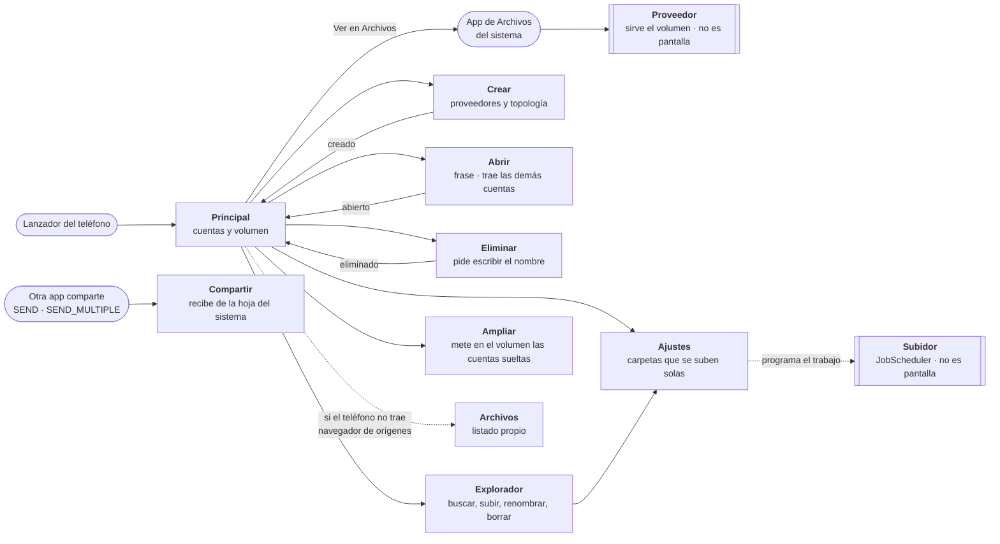
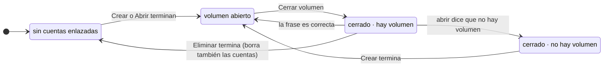

# La aplicación de Android

Qué hay que construir, qué está ya comprobado y qué decisiones quedan tomadas antes de escribir
código. El análisis de por qué Android no es un tercer objetivo de montaje está en
[ROADMAP.md](ROADMAP.md#móvil-android); aquí se da por sabido y se pasa al cómo.

## Lo que ya está medido, no supuesto

| Qué | Resultado | Cuándo |
|---|---|---|
| `crypto`, `raid`, `backend` y `core` cruzan a `aarch64-linux-android` | sí, con NDK r30 | 29-09-2026 |
| El binario **enlaza**, no solo compila | ELF aarch64 de 17 MiB | 29-09-2026 |
| Argon2id en un TECNO POVA 5 (Android 14) | **95 ms** de mediana, contra 22 ms en el escritorio | 29-09-2026 |
| HTTPS desde un binario sin JVM | **entra en pánico**, ver más abajo | 29-09-2026 |

Los 95 ms son la cifra que evita un problema que no tendría arreglo: los parámetros de
Argon2id van ligados al volumen, así que si el móvil hubiera necesitado otros, un volumen
creado en el escritorio se abriría lento en el móvil **para siempre**. No es el caso, y por eso
no hay que decidir nada al respecto.

La línea de órdenes no cruza, y está bien: arrastra `fuser`. FUSE no existe para Android.

## El proyecto de Android

Vive en [`android/`](../android), **aparte del workspace de Rust**: son dos sistemas de
construcción que no se entienden entre sí, y mezclarlos obligaría a quien solo quiere compilar
el escritorio a tener instalado un SDK que no necesita.

El puente entre los dos es [`packaging/android/compilar.ps1`](../packaging/android/compilar.ps1),
que construye el `.so` con cargo y lo deja en `android/app/src/main/jniLibs/arm64-v8a/`.

```powershell
$env:ANDROID_NDK_HOME = "C:\Users\Luis\Android\android-ndk-r30"
.\packaging\android\compilar.ps1          # el .so
cd android; .\gradlew.bat assembleDebug   # el APK
```

`jniLibs/` no va al repositorio: es la salida de cargo copiada. Versionarla significaría que
alguien puede clonar y compilar un APK con un núcleo que no corresponde a las fuentes que tiene
delante.

El *wrapper* de Gradle sí va, y **con la huella de la distribución** en
`gradle-wrapper.properties`: es lo que hace que el Gradle que se descargue solo sea el que
esperamos y no lo que haya en esa URL ese día.

## Lo que la aplicación ya hace

La primera lista se probó de punta a punta en un TECNO POVA 5 (Android 14) el 29 de septiembre
de 2026. Lo de abajo del todo se añadió después y está probado en tres teléfonos distintos,
instalado desde Google Play como se instala cualquier aplicación.

- **Conectar una cuenta de nube** por el navegador, desde el propio móvil.
- **Traerse las demás con la maleta**: una cuenta enlazada y la frase de paso bastan. En el
  escritorio eso ahorra minutos; en un móvil evita cuatro vueltas al navegador y cuatro
  pantallas de permisos con el teclado del teléfono.

  Probado desde cero: teléfono sin ninguna cuenta, se enlazó **solo Google Drive**, y la maleta
  trajo las otras tres. El bulto lo había escrito Windows y lo abrió Android —otra máquina,
  otra arquitectura y otro sistema operativo— con el mismo formato y el mismo sellado. Eso no
  estaba visto: lo de ayer solo demostraba que viajaba entre dos PC.
- **Abrir el volumen** con la frase.
- **Aparecer en la app de Archivos** y en el selector del sistema, y navegar por las carpetas.
- **Leer ficheros por rangos**, bajando solo los trozos que el rango toca.
- **Enterarse de lo que sube otro equipo**, deslizando para actualizar.
- **Crear un volumen desde el teléfono**, eligiendo proveedores y topología, sin pasar por el
  escritorio. Antes el móvil solo podía abrir lo que otro había creado.
- **Escribir**: crear carpetas, renombrar, borrar y subir, desde su explorador y desde la hoja
  de compartir de cualquier aplicación. Ver [«Escribir desde el móvil»](#escribir-desde-el-móvil).
- **Su propio explorador**, con buscador, fechas, tamaños, favoritos y menú lateral, en vez de
  depender de la app de Archivos del fabricante.
- **Subir carpetas del teléfono sola**, con `JobScheduler` y opción de solo WiFi.
- **Ampliar el volumen** metiéndole cuentas enlazadas que no lo formaban *(escrito, sin
  publicar todavía)*. Con una advertencia que la pantalla da antes de empezar: **solo un volumen `lineal` crece** al añadir una cuenta.
  En espejo, paridad o unión cada trozo se parte entre todas, así que una más no agranda nada
  y lo que se gana es aguantar una caída más. Ganar sitio ahí es reescribir el volumen entero,
  que tarda horas y se hace desde el escritorio.
- **Decir cuánto cabe y cuánto queda**, preguntándoselo a cada cuenta: una petición por
  proveedor, no una enumeración del árbol. *(escrito, sin publicar todavía)*.

> **Las dos últimas, y los cambios en crear y eliminar, están en el código y no en Google
> Play.** La versión que se instala hoy es la `versionCode` 12, de antes de esto. Hasta que se
> suba una nueva, el README y la portada no los cuentan a propósito: describen lo que alguien
> puede instalar, no lo que hay en la rama.

Lo que falta ya no es «que sea una aplicación y no una prueba»: es **miniaturas** —las carpetas
de fotos se ven como una lista de nombres— y decidir qué hacer cuando Android mata el proceso a
mitad de una lectura.


### Dos cosas que se corrigieron usándola

**La raíz no aparecía sin sesión.** Se hizo así con el argumento de que aparecer y fallar es
peor que no aparecer. Estaba mal: si no sale en la lista, no hay forma de distinguir «falta
abrir el volumen» de «la aplicación no va» de «estoy mirando donde no es».

**Lo subido desde otro equipo no aparecía nunca.** Un `Volume` guarda la raíz que leyó al
abrirse y no vuelve a mirar; para un escritor es correcto, para un lector no. El comentario del
código decía que no hacía falta caducidad «con un solo escritor», y eso era falso: un solo
escritor significa uno cada vez, no que el lector sea el escritor.

Las dos salieron el primer día que alguien la usó de verdad, y ninguna se habría visto
compilando.

## Las herramientas, y dónde están

Todo fuera del repositorio, en `C:\Users\Luis\Android`, y todo verificado contra la huella que
publica quien lo distribuye antes de descomprimirlo. Ninguna toca el `PATH` ni el registro: se
apuntan con variables de entorno, que es lo que permite tener varias versiones y tirar una sin
consecuencias.

| Qué | Versión | Espacio | Para qué |
|---|---|---|---|
| NDK | r30 (LTS) | 2,01 GiB | compilar Rust para `aarch64-linux-android` |
| JDK Temurin | 21.0.12.1+1 | 0,32 GiB | Gradle y el plugin de Android piden 17 o más |
| SDK: plataforma | android-36 | 0,10 GiB | contra qué se compila |
| SDK: build-tools | 36.1.0 | 0,13 GiB | empaquetar el APK |
| SDK: platform-tools | 37.0.1 | 0,02 GiB | `adb` |

**2,9 GiB en total**, de los cuales dos tercios son el NDK. Gradle no está todavía: se descarga
solo la primera vez que se compile, por el *wrapper*, y añadirá unos cientos de megas más sus
cachés.

```powershell
$env:JAVA_HOME    = "C:\Users\Luis\Android\jdk-21.0.12.1+1"
$env:ANDROID_HOME = "C:\Users\Luis\Android\sdk"
$env:ANDROID_NDK_HOME = "C:\Users\Luis\Android\android-ndk-r30"
$env:PATH = "$env:JAVA_HOME\bin;$env:ANDROID_HOME\platform-tools;$env:PATH"
```

En esta máquina hay además un Java 8 en el `PATH` del sistema, de otra cosa. No se ha tocado:
poniendo `JAVA_HOME` delante, Gradle usa el 21 y el otro sigue donde estaba para quien lo
necesite.

Las licencias del SDK de Google están aceptadas en `sdk\licenses`. Se revocan borrando esa
carpeta, o el SDK entero.

## El flujo de pantallas

Sacado del código, no dibujado a mano: las entradas salen del manifiesto, las flechas de las
llamadas a `startActivity`, y los estados de qué toca `Sesion`. Si algo de esto no coincide con
lo que hace la aplicación, el que miente es el diagrama.

Van dos, porque son dos cosas distintas: por dónde se entra y se pasa, y en qué estado está
`Principal` mientras tanto.

### Las pantallas



### Los cuatro estados de `Principal`

`Principal` es una sola `Activity`, pero `pintar()` enseña botones distintos según si hay
cuentas enlazadas, si la sesión está abierta y si se sabe que en esas cuentas no hay volumen.
Dibujarla como un nodo escondería justo lo que hay que validar: que **`Abrir` y `Eliminar` solo
existen en un estado**, y **`Crear` en otro**.



Qué botones hay en cada estado, que es lo que se valida contra el teléfono:

| Estado | Lo que se ve |
|---|---|
| sin cuentas enlazadas | «Crear un volumen desde cero» y «Abrir un volumen que ya existe», y **nada más**: los botones de enlazar cuenta viven en la tarjeta de cuentas, que está oculta hasta que hay una. Se enlaza desde dentro de `Crear` o de `Abrir` |
| cerrado · hay volumen | frase de paso, **Abrir**, **Eliminar**, «Traer mis cuentas» |
| cerrado · no hay volumen | **Crear volumen** |
| volumen abierto | **Cerrar**, «Ver en Archivos», «Explorar», «Ampliar con más cuentas», «Configuración», y el tamaño del volumen con lo que le queda libre |

### Lo que el grafo dice, y hay que comprobar

| | |
|---|---|
| **Tres entradas**, no una | el lanzador, la hoja de compartir de otra aplicación, y la app de Archivos del sistema. Las dos últimas entran **sin pasar por `Principal`**, así que cada una aguanta el volumen cerrado por su cuenta: `Compartir` lo dice y no sube, y el `Proveedor` no entrega nada |
| `Crear` deja el volumen **abierto** | se abre con la frase que acabas de escribir. Antes volvía cerrado y había que escribirla otra vez en la pantalla de al lado, un minuto después, lo que no protegía de nada |
| `Crear` no sale siempre | aparece solo cuando se sabe que no hay volumen. Ofrecerlo siempre ponía dos botones a competir sin decir cuál tocaba |
| `Archivos` es un **repuesto** | solo se llega si el teléfono no trae navegador de orígenes. En uno que sí lo trae, esa pantalla no se ve nunca |
| Ningún estado es un callejón | de los cuatro se sale, y las tres pantallas que terminan vuelven a un estado **distinto** del que salieron |
| `Eliminar` deja el teléfono **como recién instalado** | además de borrar el volumen, desenlaza las cuentas: sin eso quedaban apuntando a algo que ya no existe, y empezar de cero obligaba a quitarlas una por una |


### Validado contra un teléfono

TECNO LH7n (Android 14), **con la versión de Google Play**, `versionCode` 12, el 13 de octubre
de 2026. El teléfono estaba sin cuentas enlazadas, así que se validó el estado inicial y lo que
sale de él; lo demás exige enlazar una cuenta de verdad y escribir la frase de paso, y eso no se
hizo.

Se recorrió con `adb` leyendo la jerarquía de vistas (`uiautomator dump`) en cada paso, no
mirando la pantalla.

**Confirmado:**

| | |
|---|---|
| El estado `sin cuentas enlazadas` | el texto es «Empieza por uno de los dos caminos.», y solo hay los dos botones de entrada |
| `Principal → Crear` | lleva a «CREAR VOLUMEN», con «Conectar Google Drive», «Conectar OneDrive» y «Continuar» |
| `Principal → Abrir` | lleva a «ABRIR UN VOLUMEN» |
| El «atrás» de las dos | devuelve a `Principal` |
| `Explorador`, `Ajustes`, `Archivos` y `Eliminar` **no son alcanzables desde fuera** | `am start` las rechaza con `SecurityException: not exported`. Ninguna otra aplicación puede abrirlas |
| El `Proveedor` tampoco | pedirlo directamente da `Permission Denial: requires ACTION_OPEN_DOCUMENT`. Solo el sistema entra, que es lo que el manifiesto quería |

**Lo que el teléfono desmintió del diagrama.** En el estado `sin cuentas enlazadas` **no** se
puede enlazar una cuenta desde `Principal`: `drive` y `onedrive` viven dentro de
`tarjeta_cuentas`, que está `GONE` hasta que hay una cuenta. Se enlaza desde dentro de `Crear` o
de `Abrir`. El diagrama de arriba ya está corregido; esto queda escrito porque es justo para lo
que sirve validar contra el aparato en vez de contra el código leído.

**Lo que no se pudo validar**, y por qué: los estados `cerrado · hay volumen`, `cerrado · no hay
volumen` y `volumen abierto` exigen enlazar una cuenta de nube real. `Eliminar` se deja sin
recorrer a propósito: lo que valida esa pantalla es que borre.

**Una advertencia sobre el `minSdk`.** El bundle que se subió declara `minSdkVersion="26"`
--Android 8--, y eso es lo que dicen el `build.gradle.kts` y el manifiesto fusionado. Pero el
paquete que Play instaló en este teléfono declara `minSdk=32`. Es lo normal del reparto por
variantes de Play y no prueba que la aplicación exija Android 12L, pero **tampoco está
comprobado** que instale en un Android 8. Se confirma mirando el catálogo de dispositivos en
Play Console, o instalando en un emulador con API 26.

## La forma de la aplicación

No es un montaje. Es un **`DocumentsProvider`** del Storage Access Framework: el volumen
aparece como origen en la app de Archivos y en el selector de ficheros del sistema, y cualquier
otra aplicación lee a través de `ContentResolver`. Es lo que hacen Nextcloud y Cryptomator,
porque en Android no hay otra cosa que hacer.

Consecuencia que conviene tener presente desde el principio: **una app que use rutas crudas no
verá nada**. No hay `open()` por ruta ni `mmap`. Lo que se entrega es un descriptor.

## Compartir no es el selector de ficheros

Son dos mecanismos distintos de Android, y desde fuera parecen el mismo. Confundirlos cuesta una
tarde, así que queda escrito:

| | Qué es | Dónde sale |
|---|---|---|
| **Storage Access Framework** (`DocumentsProvider`) | una lista de **sitios** | el selector del sistema: «guardar en», «abrir desde», la app de Archivos |
| **Compartir** (`ACTION_SEND`) | una lista de **aplicaciones** | el menú de compartir de cualquier app |

Un `DocumentsProvider` **nunca** aparece en el menú de compartir, por bien que funcione. Y
compartir es como la gente mete cosas en una nube desde un móvil: se abre la galería, se elige
la foto y se comparte.

Por eso hacen falta los dos, y la aplicación tiene una actividad aparte
([`Compartir.kt`](../android/app/src/main/kotlin/net/multidrive/Compartir.kt)) que recibe
`ACTION_SEND` y sube lo que llegue. Si el volumen está cerrado, o abierto solo para leer, lo
dice y explica qué hacer: aparecer en la lista y no poder recibir es peor que no aparecer.

## El contrato, y a qué corresponde de lo nuestro

`DocumentsProvider` tiene tres métodos que hay que implementar sí o sí, y el cuarto es el que
de verdad importa:

| Método de Android | Qué devuelve | Con qué se resuelve aquí |
|---|---|---|
| `queryRoots(String[])` | un `Cursor` con las raíces | una fila: el volumen. Solo aparece si hay uno configurado |
| `queryDocument(String, String[])` | metadatos de uno | `Volume::lookup` |
| `queryChildDocuments(String, String[], String)` | los hijos de un directorio | `Volume::read_dir` |
| `openDocument(String, String, CancellationSignal)` | un `ParcelFileDescriptor` | lo de la sección siguiente |

Los `documentId` son cadenas opacas para Android. Aquí serán **la ruta dentro del volumen**,
que ya es única y estable, en vez de inventar identificadores y tener que mantener una tabla.

Los métodos de escritura —`createDocument`, `deleteDocument`, `renameDocument`,
`moveDocument`— **no se implementan de momento**. Ver «Solo lectura».

### Todos se llaman desde cualquier hilo

Android no garantiza ninguno en particular y espera que sean rápidos: mientras `queryRoots` o
`queryChildDocuments` no vuelvan, la interfaz de Archivos está esperando. Nuestro `read_dir`
contra cuatro nubes puede tardar segundos.

Hay una salida prevista por el propio Android y hay que usarla: devolver un `Cursor` con
`EXTRA_LOADING` a `true`, que hace que el selector enseñe que está cargando, y notificar
después cuando estén los datos. Sin eso, la primera impresión de la aplicación es una pantalla
congelada.

## Leer por rangos, que es lo que la hace viable

Nextcloud descarga el fichero entero a un temporal para abrirlo. **Nosotros no podemos
permitírnoslo**: el troceado es de 16 MiB y `read_at` baja solo los trozos que el rango toca,
que es lo que hace posible abrir un vídeo de 2 GiB sin bajarse 2 GiB.

Para conservar eso en Android hace falta
[`StorageManager.openProxyFileDescriptor`](https://developer.android.com/reference/android/os/storage/StorageManager),
**API 26**, que devuelve un descriptor cuyas lecturas llegan como llamadas a un
`ProxyFileDescriptorCallback`:

```java
long onGetSize()                                  // Volume::lookup → len
int  onRead(long offset, int size, byte[] data)   // Volume::read_at
int  onWrite(long offset, int size, byte[] data)  // no, de momento
void onRelease()
```

Los errores se comunican lanzando `ErrnoException`, no devolviendo códigos.

Eso fija dos cosas:

- **`minSdk` = 26.** No es negociable si se quiere lectura por rangos, y sin lectura por rangos
  la aplicación es un descargador de ficheros con más pasos.
- **Las llamadas llegan por el `Handler` que se le pasa**, así que hay que crear un
  `HandlerThread` propio. No es un hilo del sistema del que se pueda abusar, y serializa las
  llamadas de un mismo descriptor, lo cual simplifica el lado de Rust.

## El verificador de la plataforma no sirve en Android

Escrito después de comprobarlo en un teléfono, y corrige lo que decía antes esta misma sección.

El componente Kotlin **sí hace falta** y **sí funciona**: sin él, la primera petición HTTPS
entra en pánico —`Expect rustls-platform-verifier to be initialized`— y se lleva el proceso por
delante. Con él, Microsoft responde `200 OK`.

Pero Google y nuestro propio sitio responden `invalid peer certificate: Revoked`, y **no lo
están**. El verificador de Android comprueba la revocación del certificado del servidor, y un
certificado sin OCSP ni CRL no se puede comprobar. Let's Encrypt ya no emite ninguna de las dos
cosas, y Google Trust Services tampoco. El resultado es que **una comprobación imposible se
reporta como una comprobación fallida**.

No hay forma de desactivarlo: el veredicto lo emite el componente Kotlin y el lado de Rust se
limita a traducirlo.

La salida, **hecha y comprobada**, es construir el `ClientConfig` de rustls con `webpki-roots`
—el conjunto de raíces de Mozilla, compilado dentro— y dárselo a `reqwest` ya hecho. Vive en
`multidrive-backend::http`, en un solo sitio y detrás de un `cfg(target_os = "android")`: en el
escritorio no cambia nada, porque ahí el verificador de la plataforma funciona y es mejor que
cualquier lista que llevemos nosotros.

Que esté en un solo sitio no es orden por el orden. Había **tres** lugares donde se fabricaba un
cliente —la consulta de cupo, el canje de OAuth y el que OpenDAL se hace solo— y arreglar dos de
tres habría dejado la aplicación funcionando en casi todo menos en conectar cuentas, que es lo
único que hace falta para que no sirva de nada. A OpenDAL se le pasa el nuestro con
`OperationContext::with_http_transport`.

Lo que se pierde hay que decirlo: el almacén de confianza pasa a ser **nuestro y no el del
sistema**, así que no recoge las actualizaciones del sistema operativo ni las raíces que haya
añadido una empresa o el propio usuario, y actualizarlo pasa a ser cosa nuestra —una dependencia
más que vigilar—. A cambio, la aplicación puede hablar con las nubes, que es el requisito del
que cuelga todo lo demás.

El `.so` pasa de 0,8 a 14,8 MiB al entrar el backend entero y OpenDAL. Es el tamaño real de lo
que hace falta para hablar con las nubes, y el APK sigue por debajo de lo que pesa cualquier
aplicación de fotos.

## El componente Kotlin de los certificados: obligatorio

Esto es lo que más cerca estuvo de ser una sorpresa cara, y por eso se comprobó pronto.

`reqwest` arrastra `rustls-platform-verifier`, que en Android busca el almacén de certificados
del sistema **a través de la JVM**. Sin inicializarlo con el `Context` de una aplicación no
falla: **aborta**.

```
thread panicked at rustls-platform-verifier-0.7.0/src/android.rs:90
Expect rustls-platform-verifier to be initialized
```

Un error se maneja, se reintenta, se le enseña al usuario. Un pánico en mitad de una petición
de red es un cierre inesperado de la aplicación. Así que:

- Hay que incluir la clase Kotlin que el crate pide y llamar a
  `rustls_platform_verifier::android::init_with_env` **al arrancar el proceso**, antes de
  cualquier petición, no en el primer uso.
- Y no hay escapatoria por configuración: `reqwest` 0.13.5 solo ofrece `rustls` y
  `rustls-no-provider`, y los dos traen el verificador de plataforma. Los certificados
  empaquetados (`webpki-roots`) no son una opción desde ahí.

## La frontera con Rust

La regla es que sea **pequeña y estable**, porque cada función que cruza es una que hay que
mantener en dos lenguajes. Todo lo que pueda vivir en Rust, vive en Rust.

```
abrir(config, frase)      -> sesión, o error
raices(sesión)            -> el volumen, o nada
mirar(sesión, ruta)       -> metadatos
listar(sesión, ruta)      -> entradas
leer(sesión, ruta, off, n)-> bytes
cerrar(sesión)
```

Seis funciones. Lo que no cruza y se queda dentro: la topología, el reparto, el cifrado, la
caché, el reensamblado de fragmentos y qué proveedor tiene qué. Kotlin no necesita saber nada de
eso, y cuanto menos sepa, menos hay que tocar cuando cambie.

**El runtime asíncrono se crea una vez** y vive en la sesión. Los métodos de Android son
síncronos y llegan desde cualquier hilo, así que el lado de Rust bloquea contra ese runtime. Es
correcto por lo mismo que en los hilos del kernel de FUSE: **no son hilos del runtime**.

## La frase de paso

No se guarda **por defecto**, igual que en el escritorio: vive en la sesión, en memoria, y muere
con el proceso. Android puede matar el proceso de un `DocumentsProvider` cuando le convenga, así
que hay que aceptar que **volver a Archivos puede pedirla otra vez**, y decirlo en vez de fingir
que la sesión es eterna.

Guardarla en el llavero para no volver a pedirla era «exactamente la clase de decisión que se
toma a sabiendas o no se toma», y decía aquí que de momento no. Ahora sí, **y solo para una
cosa**: la subida automática de carpetas. Un trabajo que el sistema arranca a las tres de la
mañana no puede pedir una frase a nadie; sin guardarla, esa función no existe.

Las condiciones de que sí:

- **Opt-in.** No se activa con la aplicación, se activa al encender la subida automática, y la
  pantalla dice con esas palabras qué se gana y qué se cede.
- **En el llavero de Android** (`AndroidKeyStore`), cifrada por el hardware cuando el teléfono
  lo tiene, nunca en el fichero de configuración ni en `SharedPreferences` en claro.
- **`setUnlockedDeviceRequired`**: con el teléfono bloqueado la clave no descifra, así que un
  teléfono apagado o bloqueado no entrega el volumen. Un teléfono desbloqueado en manos ajenas
  sí: eso es el precio y está dicho.
- **Se puede apagar**, y apagarlo borra la entrada del llavero.

Ver [`Llave.kt`](../android/app/src/main/kotlin/net/multidrive/Llave.kt).

## Escribir desde el móvil

Esto decía «solo lectura», y que un móvil escribiendo en un volumen que el escritorio también
escribe *era* el problema de escritura concurrente que estaba fuera de alcance. Dejó de serlo
cuando llegó el *rebase y reintento* del árbol: dos máquinas que tocan ficheros distintos ya no
se pisan, porque la que pierde la carrera por el puntero de raíz vuelve a aplicar su cambio
sobre la raíz nueva en vez de rendirse. El *lease* sigue ahí, pero ya no bloquea.

Así que se implementan: `createDocument`, `deleteDocument`, `renameDocument` y la escritura por
`openProxyFileDescriptor`. Las banderas del `Cursor` lo dicen —`FLAG_SUPPORTS_WRITE` en los
ficheros, `FLAG_DIR_SUPPORTS_CREATE` en las carpetas, `FLAG_SUPPORTS_DELETE` y
`FLAG_SUPPORTS_RENAME` en todo lo que no sea la raíz—, y con eso el selector del sistema **sí**
ofrece guardar ahí.

La raíz se queda fuera a propósito: `fila()` pinta también la raíz, y sin ese `if` el sistema
ofrecía renombrar y borrar el volumen entero como si fuera una carpeta.

## Lo que el móvil impone

| Problema | Qué obliga a hacer |
|---|---|
| Doze y límites de segundo plano | `JobScheduler` con restricción de red, no un hilo propio. **No `WorkManager`**: arrastraría androidx a un proyecto que no lo usa, y `JobScheduler` da lo mismo desde API 21. Y hace falta `ACCESS_NETWORK_STATE`, o `schedule()` lanza `SecurityException` |
| Datos móviles | `rs(4,2)` sube 1,5× y leer exige *k* fragmentos de *k* cuentas distintas. Hay política de **solo WiFi** (`NETWORK_TYPE_UNMETERED`), y se puede cambiar |
| Batería | Argon2id una vez por sesión ya se midió: 95 ms. Reed-Solomon y XChaCha20 son por trozo, y eso sí escala con lo que se lea |


Con los ~6,5 s por operación medidos contra Drive
([VIABILIDAD.md](VIABILIDAD.md#5-medidas-reales-contra-google-drive)), sobre red móvil la
latencia manda sobre todo lo demás. La caché en disco deja de ser una optimización y pasa a ser
lo que hace usable la aplicación.

## Lo que no se copia

La app de Nextcloud resuelve los mismos problemas de integración y merece estudiarse. Pero su
repositorio es **GPLv2 con aportaciones posteriores a junio de 2016 en AGPLv3-or-later**, o sea
una mezcla, y su `DocumentsStorageProvider.java` viene del linaje de ownCloud, anterior a ese
cambio. Copiar de ahí exigiría rastrear la procedencia línea a línea.

Se aprende la forma y se escribe la nuestra. Que además es distinta: ellos hablan WebDAV contra
un servidor que ve los ficheros, y aquí hay que descifrar y recomponer trozos de varias cuentas
antes de entregar un byte.

## Por dónde se empieza

1. ~~**Cargar el núcleo desde una app vacía** y que diga la versión.~~ **Hecho el 29 de
   septiembre de 2026**, corriendo en el TECNO POVA 5:

   ```
   Nucleo cargado
   version   0.0.1
   prueba    rs:4,2: tolera perder 2, sobrecoste 1.50x
   abi       arm64-v8a, armeabi-v7a, armeabi
   ```

   La segunda línea es la que importa: está **calculada** por el motor RAID dentro del `.so`,
   no escrita. Un «hola» no habría distinguido «se cargó el núcleo» de «se cargó una
   biblioteca vacía con el nombre correcto».

   Dos cosas que no estaban previstas y se resolvieron por el camino. **Desde AGP 9.0 el
   plugin de Kotlin va dentro del de Android**: declararlo aparte no es redundante, es un
   error de compilación que dice «ya no hace falta». Y **`cargo-ndk` no se usa**: el `.so` lo
   construye `packaging/android/compilar.ps1` con cargo y tres variables de entorno, que es lo
   que `cargo-ndk` haría por debajo, y lo copia a `jniLibs`. Una dependencia menos y una capa
   menos donde mirar cuando algo falle. El día que haya que compilar cuatro arquitecturas y
   esto se vuelva incómodo, se cambia entonces.

   Ese guion comprueba además que el `.so` **exporta los símbolos `Java_`**. Sin ellos la
   aplicación compila, instala, arranca y falla al llamar, que es el peor momento para
   enterarse.
2. **Inicializar el verificador de certificados** y hacer un HTTPS cualquiera. **Hecho a
   medias el 29 de septiembre de 2026**, y lo que faltó es más interesante que lo que salió.

   Con el `.aar` del crate empaquetado y `init_with_env` llamado desde `onCreate`, **el pánico
   desaparece**: el verificador funciona. Pero al probar contra tres sitios:

   ```
   propio  FALLO: invalid peer certificate: Revoked
   google  FALLO: invalid peer certificate: Revoked
   msft    200 OK en 1681 ms
   ```

   Ninguno de esos certificados está revocado. Lo que pasa es que **Android comprueba la
   revocación y no puede**: `multidrive.net` lleva un certificado de Let's Encrypt que ya no
   trae ni OCSP ni CRL —comprobado extensión a extensión—, y el de Google tampoco. Sin de
   dónde sacar la información, el verificador de la plataforma responde `Revoked`, que es lo
   peor que podía responder: una comprobación que no se puede hacer sale como una que salió
   mal.

   Y no hay interruptor. El veredicto lo da el componente Kotlin, y el lado de Rust solo lo
   traduce.

   **Google es el proveedor principal de MultiDrive**, así que esto no es una curiosidad: con
   el verificador de la plataforma, la aplicación de Android no puede hablar con Drive.

   **Resuelto el mismo día** con `webpki-roots` en Android, y comprobado en el teléfono:

   ```
   propio  200 OK en 184 ms
   google  404 Not Found en 288 ms
   msft    200 OK en 1105 ms
   ```

   El 404 de Google es la respuesta correcta a un `GET /` sobre `oauth2.googleapis.com`: lo
   que importa es que **contestó**, o sea que el saludo TLS se completó. Los 184 ms contra
   nuestro propio sitio son además el primer dato de red desde el móvil.
3. ~~**Abrir un volumen y listar la raíz** por JNI.~~ **Hecho el 29 de septiembre de 2026**,
   sobre un `lineal:4` de OneDrive y tres cuentas de Drive, desde el TECNO POVA 5:

   ```
   cabecera     3063 ms
   clave         156 ms
   abrir        1685 ms
   listar /     1229 ms

   lineal:4 sobre onedrive, gdrive, gdrive1, gdrive2
   0 entrada(s)
   ```

   **Seis segundos para abrir y listar**, y de ellos **156 ms son CPU**. Todo lo demás es red.
   Esto decide el diseño de la aplicación más que cualquier otra medida que hayamos tomado:

   - La **caché deja de ser una optimización**. Sin ella, cada vuelta a la app son seis
     segundos antes de ver un nombre.
   - `EXTRA_LOADING` no es cortesía: sin él, el selector de ficheros se queda quieto ese rato
     y cualquiera lo lee como una aplicación rota.
   - Y Argon2id, que era la sospecha inicial, **no es el problema**. Nunca lo fue.

   Un matiz que conviene no olvidar al releer estas cifras: la raíz estaba **vacía**, así que
   `listar /` de 1229 ms es el suelo. Un directorio con contenido paga más.

   El mismo sondeo HTTPS, tres veces en la misma tarde y el mismo teléfono, dio 184, 3361 y
   1291 ms contra nuestro sitio. Eso es red móvil: cualquier cifra suelta de aquí es un
   semáforo, no una medida.
4. ~~**El `DocumentsProvider`**, con `EXTRA_LOADING`.~~ **Hecho.** Las sesiones son lo nuevo de
   verdad: abrir cuesta seis segundos, así que se abre una vez y se guarda, y Kotlin recibe un
   número y no un puntero envuelto —así un identificador equivocado es un error y no un fallo
   de memoria—.

   Y una corrección que salió de usarlo: al principio **no se publicaba ninguna raíz mientras
   no hubiera sesión**, con el argumento de que aparecer y fallar es peor que no aparecer.
   Estaba mal. Si MultiDrive no sale en la lista, no hay forma de distinguir «falta abrir el
   volumen» de «la aplicación no va» de «estoy mirando donde no es», y ninguna de las tres se
   arregla a ciegas. Ahora sale siempre y el resumen dice en qué estado está.

5. ~~**`openProxyFileDescriptor`** para leer por rangos.~~ **Hecho.** Cada lectura del
   descriptor se traduce en un `read_at`, que baja solo los trozos que el rango toca.

   Las lecturas llegan por un `HandlerThread` propio, uno para todo el proceso. Eso
   **serializa** las lecturas de todos los ficheros abiertos a la vez: es una limitación de
   verdad y conviene saberla. A cambio, las de un mismo fichero llegan en orden y el lado de
   Rust no necesita candados. Cuando haya un caso que lo pida —dos aplicaciones leyendo a la
   vez— se pasa a uno por descriptor.

6. **Conectar cuentas desde el móvil**, para no tener que pasar credenciales por cable.
   **Hecho**, y antes de lo previsto porque probar sin ello obligaba a dejar tokens de refresco
   en el teléfono. El flujo de OAuth no se reescribió: es el mismo de la ventana y el terminal,
   con PKCE y el `state` comprobado, y lo único que cambia es quién abre el navegador.

Los tres primeros no necesitan interfaz ninguna, y el tercero contesta la pregunta que quedó
abierta el 29 de septiembre.
